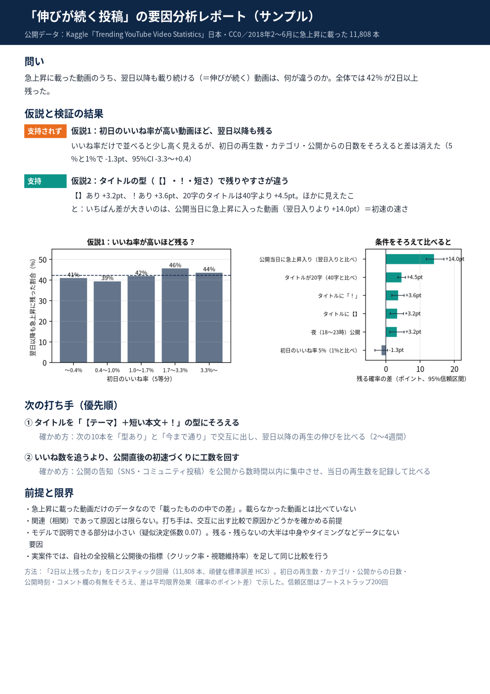

# 「伸びが続く投稿」の要因分析（仮説 → 検証 → 提案の1枚レポート・サンプル）

作成：2026-10-20
（このフォルダの位置づけ）**問い → 仮説2つ → 検証 → 次の打ち手2つ（確かめ方つき） → 前提と限界** まで1枚に書いた「提案型」のサンプル。出品ページのサンプル画像に使う

## データ
- Kaggle「Trending YouTube Video Statistics」（datasnaek/youtube-new）の日本分。CC0（再配布・商用利用とも可）
- 2018-02〜06 に急上昇に載った動画のうち、2018年以降に公開・公開から7日以内に急上昇入り・評価が有効の 11,808 本
- 元データ（約29MB）はこのリポジトリに入れていない。Kaggle（https://www.kaggle.com/datasets/datasnaek/youtube-new）から `JPvideos.csv` と `JP_category_id.json` を落とし、`prep.py` の `D` をその場所に変えると再現できる

## 問いと結果
- 問い：急上昇に載った動画のうち、翌日以降も載り続ける（伸びが続く）動画は何が違うか（全体の42%が2日以上残った）
- 仮説1「初日のいいね率が高いほど残る」→ **支持されず**（条件をそろえると 5% と 1% の差 −1.3pt、95%CI −3.3〜+0.4）
- 仮説2「タイトルの型で残りやすさが違う」→ **支持**（【】 +3.2pt、！ +3.5pt、20字は40字より +4.5pt）
- ほかに：公開当日に急上昇に入った動画は翌日入りより +14.0pt（初速）

## 次の打ち手
1. タイトルを「【テーマ】＋短い本文＋！」にそろえる → 次の10本を交互に出して比べる
2. いいね数より公開直後の初速づくりに工数を回す → 告知を公開から数時間以内に集中し、当日の再生数を記録して比べる

## 方法
- 「2日以上残ったか」のロジスティック回帰（頑健な標準誤差 HC3）。初日の再生数・カテゴリ・公開からの日数・公開時刻・コメント欄の有無をそろえた
- 差は平均限界効果（確率のポイント差）、95%CI はブートストラップ200回（`out/effects.csv`）。オッズ比は `out/odds_ratios.csv`
- 関連（相関）であって原因とは限らない。打ち手は交互に出す比較で確かめる前提

## ファイル
- `proposal_report.py`：レポートを作るスクリプト（分析テンプレート `analysis_kit.py` の色・フォント・折り返しを使う）
- `prep.py`：データの読み込みと特徴量
- `out/proposal_1page.pdf`・`.png`：1枚レポート／`fig1_h1.png`・`fig2_effects.png`：図
