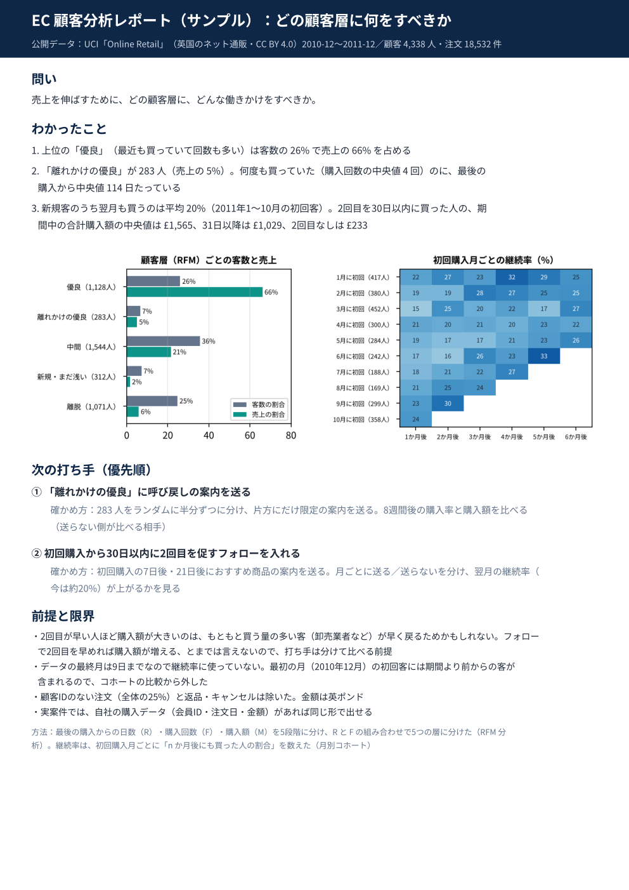

# EC 顧客分析（RFM・月別コホート → 打ち手2つ）の1枚レポート・サンプル

作成：2026-10-20
目的：YouTube・SNS 以外の分野（EC・会員データ）も扱えることを見せる、出品ページ用の2本目のサンプル

## データ
- UCI Machine Learning Repository「Online Retail」（https://archive.ics.uci.edu/dataset/352/online+retail）
- ライセンス：CC BY 4.0（出典を示せば共有・加工・商用利用可）。2026-10-20 に UCI のページで確認
- 英国のネット通販（ギフト雑貨、卸売の客も多い）の 2010-12-01〜2011-12-09 の明細 541,909 行
- 顧客IDのない行・返品／キャンセル・数量や単価が0以下を除き 397,884 行、顧客 4,338 人、注文 18,532 件
- 元データ（約23MB）はこのリポジトリに入れていない。UCI のページから `Online Retail.xlsx` を落とし、`data/` に置くと再現できる

## わかったこと（相関。原因とは限らない）
- 「優良」（R・F とも上位）は客数の26%で売上の66%
- 「離れかけの優良」283人（売上の5%）：購入回数の中央値4回、最後の購入から中央値114日
- 新規の翌月継続率は平均20%（2011年1〜10月の初回客）。2回目が30日以内の人の期間中の購入額の中央値 £1,565、31日以降 £1,029、2回目なし £233

## 次の打ち手
1. 「離れかけの優良」に呼び戻しの案内 → ランダムに半分ずつ分けて8週間比べる
2. 初回購入から30日以内に2回目を促すフォロー → 月ごとに送る／送らないを分け、翌月の継続率を比べる

## ファイル
- `ec_report.py`：分析と1枚レポートのスクリプト（分析テンプレートの色・フォント・折り返しを使う）
- `out/ec_1page.pdf`・`.png`、`fig1_rfm.png`・`fig2_cohort.png`、`rfm_segments.csv`・`cohort_retention.csv`・`second_purchase.csv`
