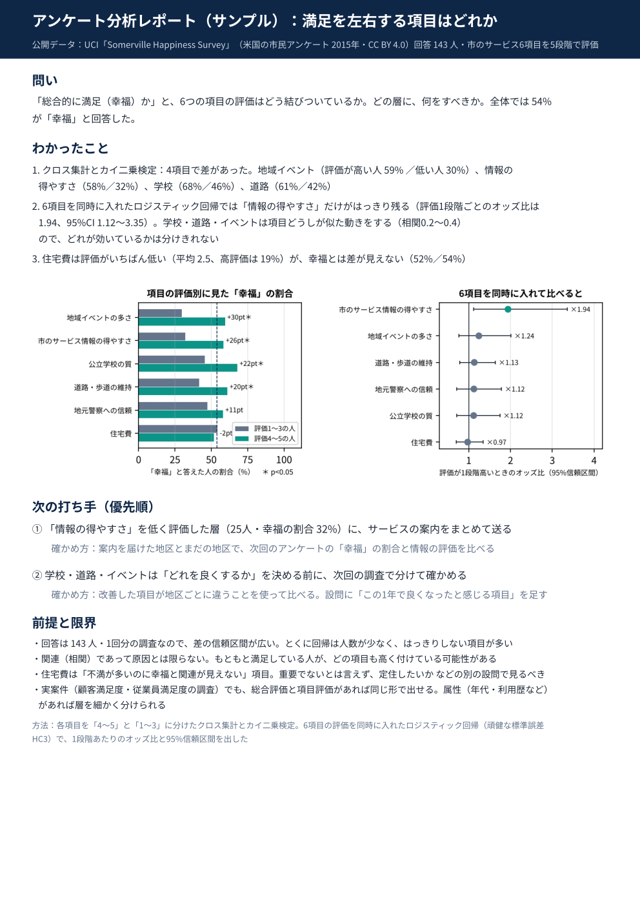

# アンケート分析（クロス集計・カイ二乗検定・ロジスティック回帰 → 打ち手2つ）の1枚レポート・サンプル

作成：2026-10-20
目的：SNS・EC に続く3分野目のサンプル。顧客満足度・従業員満足度などのアンケートも扱えることを見せる

## データ
- UCI Machine Learning Repository「Somerville Happiness Survey」（https://archive.ics.uci.edu/dataset/479/somerville+happiness+survey）
- ライセンス：CC BY 4.0（出典を示せば共有・加工・商用利用可）。2026-10-20 に UCI のページで確認
- 引用：Koczkodaj, W. (2017). Somerville Happiness Survey. UCI Machine Learning Repository. https://doi.org/10.24432/C5PW36
- 米国マサチューセッツ州サマービル市の2015年の市民アンケートの抜粋。143人。「幸福か（0/1）」と、市のサービス6項目の5段階評価
- 元ファイルは UTF-16 の CSV（`data/SomervilleHappinessSurvey2015.csv`。CC BY 4.0 のため出典つきで同梱）

## わかったこと（相関。原因とは限らない）
- 全体の54%が「幸福」
- クロス集計とカイ二乗検定：地域イベント（評価4〜5の人 59%／1〜3の人 30%）、情報の得やすさ（58%／32%）、学校（68%／46%）、道路（61%／42%）で差（p<0.05）。警察・住宅費は差が見えない
- 6項目を同時に入れたロジスティック回帰では「情報の得やすさ」だけがはっきり残る（1段階ごとのオッズ比 1.94、95%CI 1.12〜3.35）
- 住宅費は評価がいちばん低い（平均2.5）が、幸福とは差が見えない

## 次の打ち手
1. 情報の得やすさを低く評価した25人（幸福の割合32%）に、サービスの案内をまとめて送る → 届けた地区とまだの地区を次回の調査で比べる
2. 学校・道路・イベントは項目どうしの重なりが大きいので、次回の調査で分けて確かめる（設問の追加・地区ごとの比較）

## ファイル
- `survey_report.py`：分析と1枚レポートのスクリプト（このフォルダで `python survey_report.py`。`SURVEY_CSV` でデータの場所を変えられる）
- `out/survey_1page.pdf`・`.png`、`fig1_crosstab.png`・`fig2_logit.png`、`crosstab_chi2.csv`・`logit_or.csv`・`item_corr.csv`
