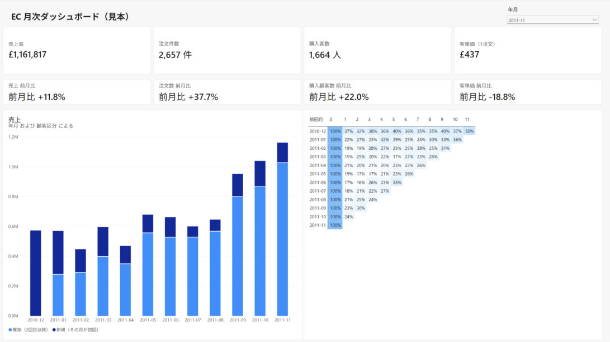

# EC 月次ダッシュボード（Power BI・1ページ）の見本

作成：2026-10-20　目的：出品ページの「月次」プランで、毎月お渡しするダッシュボードの形を見せる

- `ec_monthly_dashboard.pbix`：Power BI Desktop のファイル（データ込み）
- `out/dashboard_preview.png`：作る前に Python で描いた下絵（数字の検算用）

## データ
- UCI「Online Retail」（CC BY 4.0、https://archive.ics.uci.edu/dataset/352/online+retail）。英国のネット通販 2010-12-01〜2011-12-09
- `prep_pbi.py` で作る（返品・顧客IDなし・数量や単価が0以下を除く。EC の1枚レポートと同じ条件）
  - `data/fact_sales.csv`：明細 397,884 行（InvoiceNo, OrderDate, CustomerID, StockCode, Quantity, UnitPrice, Amount）
  - `data/dim_customer.csv`：顧客 4,338 人（初回購入月・国・英国かどうか・RFM 区分）
  - `data/check_monthly_kpi.csv`（CSV は GitHub には置かない。`python prep_pbi.py "Online Retail.xlsx"` で作る）：月ごとの KPI（Power BI の数字と突き合わせる）

## 画面（1ページ）
| 場所 | ビジュアル | 中身 |
|---|---|---|
| 上段 | カード×4 | 売上・注文数・購入顧客数・客単価。それぞれ下に前月比 |
| 左下 | 積み上げ縦棒 | 月ごとの売上を「新規（その月が初回）／既存」に分ける |
| 右下 | マトリックス（条件付き書式） | 初回購入月 × 経過月の継続率（コホート） |
| 右上 | スライサー | 年月（単一選択、既定は 2011-11）。カードだけを絞り込み、棒グラフとコホート表には効かせない（相互作用の編集） |

## 作り方（Power BI Desktop、30〜40分）
1. データを取得 → テキスト/CSV で `fact_sales.csv`・`dim_customer.csv` を読み込む（OrderDate・FirstMonth は日付型に）
2. `measures.dax` の Calendar・経過月 を「新しいテーブル」で作り、Calendar を日付テーブルとしてマーク
3. リレーション：fact_sales[CustomerID] → dim_customer[CustomerID]、fact_sales[OrderDate] → Calendar[Date]（どちらも多対1、単方向）。経過月 はつながない
4. 計算列「顧客区分」とメジャーを `measures.dax` から貼る
5. 画面を作る：カード4つ（新しいカードビジュアルで参照ラベルに前月比）／積み上げ縦棒（X=Calendar[年月]、値=売上、凡例=顧客区分）／マトリックス（行=dim_customer[FirstMonth]、列=経過月[Value]、値=コホート 継続率、背景色の条件付き書式）
6. 年月スライサーを 2011-11 にして、カードの数字を検算する（下の表と一致すれば OK）
7. ファイル → 名前を付けて保存 `ec_monthly_dashboard.pbix`、画面のスクショを `out/pbi_dashboard.png` に

## 検算（2011年11月）
| KPI | 値 | 前月比 |
|---|---|---|
| 売上 | £1,161,817 | +11.8% |
| 注文数 | 2,657 | +37.7% |
| 購入顧客数 | 1,664 | +22.0% |
| 客単価 | £437 | −18.8% |

## 作ったときの決めごと（2026-10-20）
- 12月は9日までなので、Power Query で 2011-11-30 までに絞った（締まった月だけの月次ダッシュボード）
- カードの数字は表示用のメジャー（FORMAT で「£1,161,817」「2,657 件」）にした。新しいカードの自動の表示単位で「3K」と丸められるため
- コホートの行は日付の階層にならないよう、文字の列「初回月」（yyyy-mm）を使った。合計の行・列は消した
- 継続率の背景色は白→青のグラデーション（空欄は色を付けない）

## 注意
- 2011-12 は9日までなので、前月比の表示では使わない（スライサーの既定を 2011-11 に）
- 2010-12 は記録の初月なので、それ以前からの客も「新規」に入る
- 相関の話はしない（月次の集計と推移だけ）
