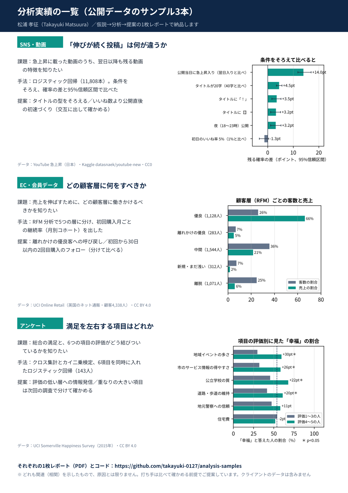

# analysis-samples：公開データで作った分析サンプル4本（仮説 → 分析 → 提案の1枚レポート／月次ダッシュボード）

SNS・EC・アンケートの3分野で、「問い → 仮説 → 検証 → 次の打ち手（確かめ方つき）→ 前提と限界」を A4 1枚にまとめたサンプルと、毎月お渡しする Power BI ダッシュボードの見本です。
**すべて公開データだけで作っています。クライアントのデータは含みません。**

一覧の PDF：[analysis_samples_overview.pdf](analysis_samples_overview.pdf)

| フォルダ | 分野・問い | わかったこと（1行・相関） | 手法 | 成果物 |
|---|---|---|---|---|
| [01_sns_trending](01_sns_trending) | SNS・動画：「伸びが続く投稿」は何が違うか（YouTube 急上昇・日本・11,808本） | 公開当日に急上昇入りした動画は翌日入りより残りやすい（+14.0pt）。初日のいいね率とははっきりした関連なし | ロジスティック回帰・平均限界効果・ブートストラップ | [1枚レポート PDF](01_sns_trending/out/proposal_1page.pdf) |
| [02_ec_retail](02_ec_retail) | EC：どの顧客層に何をすべきか（英国のネット通販・顧客4,338人） | 「優良」客は客数の26%で売上の66%。「離れかけの優良」が283人 | RFM 分析・月別コホートの継続率 | [1枚レポート PDF](02_ec_retail/out/ec_1page.pdf) |
| [03_survey](03_survey) | アンケート：満足を左右する項目はどれか（市民アンケート・143人） | 6項目を同時に見ると「情報の得やすさ」だけがはっきり残る（オッズ比 1.94） | クロス集計・カイ二乗検定・ロジスティック回帰 | [1枚レポート PDF](03_survey/out/survey_1page.pdf) |
| [04_monthly_dashboard](04_monthly_dashboard) | 月次：毎月の数字をどう見せるか（02 と同じ EC データ） | KPI 4つと前月比、新規／既存の月次売上、初回購入月別の継続率を1ページに | Power BI（DAX・Power Query・条件付き書式） | [画面](04_monthly_dashboard/out/pbi_dashboard.png)・[.pbix](04_monthly_dashboard/ec_monthly_dashboard.pbix) |

## English summary (3 lines each)
**01 SNS / video – what makes a trending video stay trending** (YouTube Trending, Japan, 11,808 videos)
- Goal: find which early signals are associated with a video staying on the trending list.
- Method: logistic regression with average marginal effects and bootstrap intervals.
- Finding / proposal: videos that enter trending on their publish day stay longer (+14.0 pt); focus effort on day-0 momentum (promote within hours of publishing) and test a consistent title format with alternating releases.

**02 EC – which customer segment to act on** (UCI Online Retail, 4,338 customers)
- Goal: decide which customers to target with what action.
- Method: RFM segmentation and monthly cohort retention.
- Proposal: win back the 283 "at-risk loyal" customers (loyal customers are 26% of customers but 66% of revenue) with a randomised 8-week test, and prompt a second purchase within 30 days of the first.

**03 Survey – which item drives satisfaction** (UCI Somerville Happiness Survey, 143 respondents)
- Goal: identify the items most associated with overall satisfaction and the groups to prioritise.
- Method: cross-tabulation, chi-square tests and logistic regression on all six items together.
- Proposal: improve "availability of information" first (the only item that remains clear, odds ratio 1.94), and confirm it in the next survey.

**04 Monthly dashboard – how to report the numbers every month** (same data as 02)
- Goal: show the monthly KPIs a client checks every month on one page.
- Method: Power BI (DAX, Power Query, conditional formatting) with four KPIs, month-over-month change, new vs. returning revenue and cohort retention.
- Proposal: use it as the monthly deliverable, with a short comment on the next month's numbers.

## データとライセンス
- 01：Kaggle「Trending YouTube Video Statistics」（datasnaek/youtube-new）日本分・CC0。元データは同梱していない
- 02：UCI Machine Learning Repository「Online Retail」・CC BY 4.0（https://archive.ics.uci.edu/dataset/352/online+retail）。元データは同梱していない
- 03：UCI Machine Learning Repository「Somerville Happiness Survey」・CC BY 4.0（Koczkodaj, W. (2017). https://doi.org/10.24432/C5PW36）。CSV（4KB）を同梱
- 04：02 と同じ「Online Retail」。.pbix にはデータが入っている（CC BY 4.0 の範囲で再配布）。CSV は `prep_pbi.py` で作り直せる

## 書き方の約束
- 結果は関連（相関）で、原因とは限らない。打ち手は「比べて確かめる」方法とセットで出す
- 人数・期間・データの偏りなどの限界を、レポートの中に必ず書く

## 使っている道具
Python（pandas・statsmodels・scipy・matplotlib。02 は Excel を読むので openpyxl も）、Power BI Desktop（04）。共通の色・フォント・日本語の折り返しは `analysis_kit.py`

## 動かし方
`pip install pandas numpy scipy statsmodels matplotlib openpyxl` のあと、各フォルダに入って `python proposal_report.py`（01）・`python ec_report.py`（02）・`python survey_report.py`（03）。結果は各フォルダの `out/` に出る。日本語フォント（Noto Sans CJK・游ゴシック・メイリオのどれか）がない環境では、図の日本語が出ない

## ご依頼について
同じ形の分析を、お手元のデータ（SNS のアナリティクス・購入データ・アンケートなど）で行います。ココナラ・ランサーズで受け付けています。
- ライト：現状集計の1枚レポート／スタンダード：仮説 → 分析 → 提案（打ち手は確かめ方つき）／月次：スタンダード＋ダッシュボード（04 の形）と翌月の定例コメント
- ココナラ：https://coconala.com/services/4459065 ／ランサーズ：https://www.lancers.jp/menu/detail/1349574
- 名前や社名は ID に置き換えて扱い、データは納品後に削除します

作成：2026-10-20（04 を追加：同日）　松浦 孝征（https://github.com/takayuki-0127）
